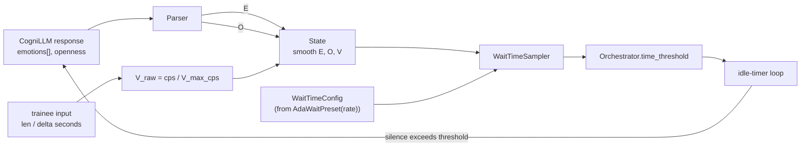

# AdaWait — adaptive wait-time controller

AdaWait decides **how long the client will tolerate silence before it speaks on
its own**. It replaces a fixed "wait N seconds, then prompt" timer with one
derived from the client's emotional state, openness, and the trainee's typing
velocity.

This document explains *why* it is built the way it is, and **verifies** every
number it quotes against the code (see [Verification](#verification)).

---

## 1. Why an adaptive wait at all

The client is an LLM-driven simulated person. The trainee is a human practising
a conversation. The pacing between the two is not cosmetic:

| If the timer is… | …too short | …too long |
|---|---|---|
| Effect | the client talks over a trainee who is still composing; the simulation reads as impatient and fake | the trainee waits at an empty screen and the exercise loses its rhythm |
| Cost | breaks the realism the whole simulator exists for | wastes the trainee's time and stalls the session |

A single fixed number cannot serve both cases, because **the right wait depends
on the client's state** — the same 30 seconds is impatient for a withdrawn
client and generous for an anxious one. And the state is not directly readable:
it arrives as the client's own free-text `emotions` list and an `openness`
label, plus whatever the trainee's typing reveals.

So the design target is:

1. **State-driven** — derive the wait from signals the simulator already
   produces, with no extra LLM call.
2. **Bounded and tunable** — a supervisor must be able to answer "make the
   client more patient" without touching the model. One knob (`rate`) should do
   it, and the resulting range must be explainable in seconds.
3. **Alive, not metronomic** — two turns in identical state should not produce
   identical waits, or the client reads as a timer.
4. **Cheap** — no model load and no network call, so it can sit on every
   response in the hot path.

Those four targets explain essentially every decision below.

---

## 2. Where it sits



The orchestrator owns the loop; AdaWait only answers *"how long is the next
interval?"* after each completed turn:

```python
# orchestrator.py
preset = AdaWaitPreset(rate=rate)                 # rate comes from config.yaml
adawait_cfg = preset.to_config(verbose=verbose)
self._adawait = AdaWaitController(adawait_cfg)
self._time_threshold = adawait_cfg.tau_max        # before the first response
...
self._time_threshold = self._adawait.compute_wait(response, V_raw=V_raw)
```

AdaWait performs no I/O and no model call. `_time_threshold` is read by the
idle-timer loop, which fires `[[System: N seconds have passed in silence…]]`
once the trainee has been quiet that long.

> **Two clocks, not one.** This is the *idle / adaptive-wait* clock. The
> separate *debounce* clock (`debouncer/`, `typing_aware`) decides how long to
> keep collecting a burst of user messages before the client answers.
> `typing_aware` has its own four-bucket waits and does **not** touch this one
> unless `suppress_idle_timer_while_typing: true`. Do not conflate them.

---

## 3. The three signals: E, O, V

Three numbers in `[0, 1]`, smoothed, are all the sampler sees.

| Signal | Meaning | Source | Direction |
|---|---|---|---|
| **E** | *patience* — how long this client will happily wait | `emotions` → [`EmotionScore`](utils/models/emotions.py) | higher E → **longer** wait |
| **O** | *openness* — how receptive the client is | `openness` label → [`OpennessScore`](utils/models/openness.py) | higher O → **longer** wait |
| **V** | typing *velocity* — how fast the trainee is typing | `len(msg) / Δt` in the orchestrator | higher V → **shorter** wait |

**Why patience rather than valence for E.** This is the one place the design has
been revised, and the reason is worth recording. A valence score
(positive ↔ negative) cannot express what turn-taking needs, because two
*unpleasant* states want *opposite* waits:

- `negative` (withdrawn, disengaged) → the client has checked out; piling
  messages on makes it worse → **longest** wait.
- `anxious` (nervous, irritated, eagerly waiting) → the client wants to be
  heard *now* → **shortest** wait.

Both are "unpleasant", so valence alone orders them the same way — which is
wrong. E is therefore defined as patience, and the four emotion buckets map
onto it directly (section 6). The old sentence-transformer valence scorer was
removed for exactly this reason, and because it also cost a model load in the
hot path.

**Why openness is a separate signal.** Openness is not an emotion: a calm
client and a guarded one can both be "neutral" emotionally while differing in
how much they will engage. It is reported separately by the client, so it is
kept as its own axis rather than folded into E.

**Why V is derived, not reported.** Nobody tells us how fast the trainee types;
it is measured. `V_raw = min(1, cps / V_max_cps)` with `V_max_cps = 8.0`
chars/s, computed only when a previous user message exists
(`V_raw = None` on the first message and on timer-driven turns, which leaves V
*frozen* — a deliberate choice: one measurement should not move the state in a
direction nobody reported).

---

## 4. The wait-time model, and why it is shaped like this

```python
lambda_0 = lambda_base * (alpha_E*(1-E) + alpha_O*(1-O) + alpha_V*V)   # α = 1.20, 1.00, 0.40
gamma    = gamma_E*(1-E) + gamma_O*(1-O) + gamma_V*V                    # γ = 0.80, 0.60, 0.30

Epsilon = Exp(1)                                    # unit-mean randomness
time    = (T_half / gamma) * ln(1 + gamma*Epsilon / (lambda_0 * T_half))
```

Three properties follow from the maths, and each is the reason for a choice:

1. **`(1-E)`, `(1-O)`, `V` make the wait monotone in the right direction.**
   High E or O pushes `lambda_0` down and the wait up; high V raises it and
   pulls the wait down. Verified in section 7.
2. **A pure exponential would be wrong, because patience is not memoryless.**
   With `gamma -> 0` the expression collapses to `Exp(lambda_0)` -- a flat
   hazard, i.e. a client exactly as likely to break the silence at second 90 as
   at second 1. The `gamma` term instead makes the hazard *grow* with elapsed
   silence, `lambda_0 * exp(gamma*x/T_half)` (Gompertz-shaped): the longer the
   quiet has lasted, the more the client is pressing to speak. Verified
   empirically in section 7 -- the measured hazard climbs 0.0014 -> 0.0042 ->
   0.0114 -> 0.0296 per second over the first 40 s, against a flat 0.0008 for
   the exponential. That is what keeps very long waits from being as likely as
   memorylessness would make them, and `T_half` sets the timescale on which the
   pressure builds.
3. **The two terms reinforce, which is why the response is monotone.**
   Higher E lowers `lambda_0` (**longer** wait) *and* lowers `gamma`, and
   `(T_half/gamma) * ln(1 + gamma*c)` — where `c = Epsilon/(lambda_0*T_half)` —
   also decreases as `gamma` falls (**longer** wait). Because both point the
   same way the net response is monotone rather than cancelling: measured at
   `O=V=0.5`, `E 0.0 -> 33.3 s` and `E 1.0 -> 72.6 s`.

### Why rejection sampling instead of `min(max(t, lo), hi)`

The band `[tau_min, tau_max]` is enforced by **re-sampling up to 100 times**
and only then falling back to the midpoint. Clamping would pile probability
mass on the two boundary values — a supervisor would see the client "always"
waiting exactly 28.0 s, which is precisely the metronomic behaviour target 3
rules out. Rejection keeps the shape of the distribution inside the band.

Measured over 20 000 samples at `E=O=V=0.5`, `rate=0.8`:

| quantity | value |
|---|---|
| samples inside `[28, 96]` | **100.00 %** |
| midpoint fallback used | **0.000 %** |
| min / mean / max | 28.0 s / 44.0 s / 66.8 s |

### Why a distribution at all (target 3)

Two turns in the same state must not produce the same wait. The randomness is
`Epsilon`, sampled per turn, and it is the *only* stochastic element — the state
itself is deterministic and re-derivable. That makes behaviour reproducible to
debug (`plot_distribution()`) while still feeling alive in the session.

---

## 5. One knob: `rate`

`AdaWaitPreset(rate)` derives the whole band. `rate` lives in
`backend/config.yaml` (`rate:`) and is passed straight through.

```python
r          = max(0.1, rate)
tau_min    = max(2.0, 60*r - 20)      # floor of 2 s for very eager settings
tau_max    = 120*r
T_half     = 10*r
lambda_base = 0.0005 / r
```

Verified table (`AdaWaitPreset(r).to_config()`):

| `rate` | band `[τ_min, τ_max]` | `T_half` | `lambda_base` | reading |
|---|---|---|---|---|
| 0.25 | 2.0 – 30.0 s | 2.5 | 2.00e-03 | eager |
| 0.5 | 10.0 – 60.0 s | 5.0 | 1.00e-03 | moderate |
| **0.8** | **28.0 – 96.0 s** | **8.0** | **6.25e-04** | **current default in `config.yaml`** |
| 1.0 | 40.0 – 120.0 s | 10.0 | 5.00e-04 | patient |
| 2.0 | 100.0 – 240.0 s | 20.0 | 2.50e-04 | very patient |

**Why one knob and not five.** Target 2: a supervisor asking for a more patient
client should change one number, and the change should be legible. Scaling band,
decay time-scale, and base rate together keeps the *shape* of the pacing
constant and moves only its scale — so tuning `rate` widens or narrows the wait
without ever turning the distribution into a spike or a uniform draw.

**Why the `tau_min` floor.** Without `max(2.0, 60r - 20)`, `rate ≤ 0.33` would
produce a non-positive lower bound. The floor keeps the invariant
`0 < tau_min < tau_max` for every admissible rate, so the rejection loop always
has a non-empty band to hit.

**Initial threshold.** Before the first response the orchestrator uses
`tau_max` outright (96 s at `rate=0.8`), with no sampling. Rationale: nothing is
known about the client yet, so the safest failure is to be *too* patient once;
after one turn, real signals exist. Note this means `E0`, `O0`, `V0` do **not**
affect the first interval.

---

## 6. Emotion → E: the four buckets

`EmotionScore.score()` does not score words itself. It calls
`debouncer.emotions.classify_emotion` — the *same* four-bucket classifier the
turn-taking logic uses — and maps the result:

| bucket | E | mean wait (`rate=0.8`, `O=V=0.5`) | why |
|---|---|---|---|
| `negative` | 0.90 | 67.1 s | withdrawn / disengaged → give them room |
| `neutral` | 0.85 | 62.9 s | calm, reflective → thinking, not waiting on us |
| `positive` | 0.50 | 43.9 s | engaged and patient, but keen → medium |
| `anxious` | 0.15 | 35.4 s | wound up, eager → answer quickly |

```
$ python -c "...EmotionScore().score(['Sad'])..."   → 0.90
```

**Why share the classifier.** Two halves of the pacing system (the debounce
window and this idle timer) must agree about what the client is feeling.
Reusing one vocabulary means a word can never be "anxious" for one clock and
"neutral" for the other. It also removes the sentence-transformer dependency
from this hot path.

**Why `UNKNOWN_SCORE = 0.5` for an empty/unrecognised payload.** "No emotion
reported" is a data-quality problem, not a state of mind — treating it as
`neutral` (E=0.85) would reward a client that failed to report with a long
patience it never claimed. 0.5 is also the historical default, so a regression
in the emotion path degrades to the old behaviour instead of a new extreme.

---

## 7. Verification

Every claim above is checkable from the repo root. Reproduce with the conda
interpreter (the system `python3` lacks the deps):

```bash
cd /disk2/switch/@SWITCH-RESEARCH/memgraph
/home/switch/miniconda3/bin/python - <<'PY'
from backend.lib.core.adawait.config import AdaWaitPreset
from backend.lib.core.adawait.utils.sampler import WaitTimeSampler

c = AdaWaitPreset(rate=0.8).to_config()
s = WaitTimeSampler(c)
mean = lambda st: sum(s.sample(st) for _ in range(3000)) / 3000
base = {"E": 0.5, "O": 0.5, "V": 0.5}

print("band:", c.tau_min, c.tau_max)
for E in (0.0, 0.15, 0.5, 0.85, 1.0):                       # E up => wait up
    print("E", E, round(mean({**base, "E": E}), 1))
for O in (0.0, 0.15, 0.5, 0.85, 1.0):                       # O up => wait up
    print("O", O, round(mean({**base, "O": O}), 1))
for V in (0.0, 0.25, 0.5, 0.75, 1.0):                       # V up => wait down
    print("V", V, round(mean({**base, "V": V}), 1))
PY
```

Observed (this revision, `rate=0.8`, `n=3000` per point):

| signal | values swept | mean wait | direction |
|---|---|---|---|
| E | 0.0 → 0.15 → 0.5 → 0.85 → 1.0 | 33.3 → 35.6 → 44.0 → 63.2 → 72.6 s | **increasing** |
| O | 0.0 → 0.15 → 0.5 → 0.85 → 1.0 | 34.9 → 36.9 → 44.2 → 56.6 → 65.8 s | **increasing** |
| V | 0.0 → 0.25 → 0.5 → 0.75 → 1.0 | 52.1 → 47.8 → 43.9 → 41.2 → 38.9 s | **decreasing** |

These are **Monte Carlo means**, so a re-run lands within about ±1 s of each
value (`n=3000`). The *direction* is what is being verified, and it is stable;
re-running the snippet above reproduced 33.1 → 73.3, 34.9 → 65.8 and
51.7 → 38.7. Increase `n` if you need tighter numbers, not to change the
conclusion.

Range coverage (`n=20 000`):

| state | min | mean | max | band |
|---|---|---|---|---|
| E=0.15 (anxious) | 28.0 | 35.4 | 50.9 | 28 – 96 |
| E=0.50 (positive) | 28.0 | 43.9 | 68.2 | 28 – 96 |
| E=0.90 (negative) | 28.0 | 66.9 | **96.0** | 28 – 96 |

Note the band is a *bound*, not a uniform target: a mid-patience client spends
most of its time low in the band and only a patient one walks up to `tau_max`.
That is intended — the band is the admissible envelope, the state chooses where
inside it the client lives.

### Distribution shape (hazard)

Isolating the raw sampler (no rejection band, 400 000 draws, `E=O=V=0.5`,
`rate=0.8`, so `lambda_0 = 8.1e-4` and `gamma = 0.85`) shows the hazard **rising**
with elapsed silence instead of the flat hazard an exponential would give:

| elapsed silence | measured hazard /s | flat exponential would be |
|---|---|---|
| 0 – 10 s | 0.0014 | 0.0008 |
| 10 – 20 s | 0.0042 | 0.0008 |
| 20 – 30 s | 0.0114 | 0.0008 |
| 30 – 40 s | 0.0296 | 0.0008 |
| 40 – 60 s | 0.0490 | 0.0008 |

This matches the analytic form `lambda_0 * exp(gamma*x / T_half)`: the client's
pressure to speak builds with the silence it is enduring. The practical
consequence is that the tail is thinner than an exponential's, so a two-minute
silence is rare rather than merely unusual.

### Smoothing

`State.update()` applies `new = smooth*old + (1-smooth)*raw`, so one response
cannot whiplash the pacing. Half-life in *responses* is
`ln(0.5)/ln(smooth)`:

| signal | `smooth` | half-life |
|---|---|---|
| E | 0.80 | 3.11 responses |
| O | 0.75 | 2.41 responses |
| V | 0.60 | 1.36 responses |

E is the slowest deliberately: emotion is the most consequential and the
noisiest signal (an LLM writes that list), so it should take a few consistent
turns to change the client's patience. V is the fastest because typing speed is
measured, not interpreted, and should track the trainee almost immediately.
Observed convergence of E from `E0 = 0.20` toward a repeated raw `0.90`:
`0.34, 0.452, 0.542, 0.613, 0.671, 0.716, 0.753, 0.783` — i.e. ~78 % of the way
after 8 turns, consistent with the 3.1-response half-life.

For a picture of the sampler, `AdaWaitController.plot_distribution(n=10000)`
prints an ASCII histogram with a clamp counter; that counter is expected to stay
at 0, which is the check that rejection sampling is doing its job.

---

## 8. Design decisions, each with the alternative it rejected

| Decision | Why | Rejected alternative |
|---|---|---|
| E is **patience**, not valence | unpleasant states want opposite waits (`negative` vs `anxious`) | single valence score (the old transformer) |
| Four emotion **buckets**, fixed vocabulary | no model load, no ambiguity, same read as the debouncer | embed-and-compare per word |
| Three separate signals | emotion, openness and typing are independent evidence | collapse to one "engagement" score |
| **Rejection** sampling | keeps the distribution off the boundaries | `clamp(t, lo, hi)` (spikes) |
| Band scaled by **one** `rate` | tuning stays legible and shape-preserving | expose `tau_min`/`tau_max`/`lambda` separately |
| **Smoothing** the state | one noisy LLM emotion list must not re-pace the session | use raw signals directly |
| Randomness **per turn** | alive but still reproducible in aggregate | deterministic mapping (metronome) |
| `UNKNOWN_SCORE = 0.5` | a missing reading is not a calm client | default to `neutral` (0.85) |

---

## 9. Module map and contract

| File | Responsibility |
|---|---|
| `config.py` | `WaitTimeConfig` (full parameter set) and `AdaWaitPreset` (the `rate` knob → config) |
| `controller.py` | `AdaWaitController.compute_wait(response, V_raw=None)` — the only public entry point |
| `utils/state.py` | smoothed `E, O, V` with per-signal smoothing factors |
| `utils/sampler.py` | the distribution; `sample(state) -> seconds` |
| `utils/parser.py` | `emotions`/`openness` → `{E, O}` |
| `utils/models/emotions.py` | bucket → patience `E` (shared classifier) |
| `utils/models/openness.py` | openness label → `O` |

Contract notes:

- `compute_wait()` **updates state and returns the next interval** — it is not a
  pure function. Call it once per completed client turn.
- `V_raw` is optional. Omit it (`None`) for timer-driven turns and for the first
  user message; `V` then keeps its previous value.
- `WaitTimeConfig`'s dataclass defaults (`tau_min=5`, `tau_max=12`) apply only
  when a controller is built without a config, e.g. in tests. The orchestrator
  always supplies `AdaWaitPreset(rate).to_config()`.
- `.state` and `.reset()` exist for the status payload (`adawait_state`) and for
  session resets.

## 10. Tuning and known limits

- **Raise `rate`** for a more patient client; all four derived values scale
  together. Nothing else needs editing.
- **Retune the buckets** by passing `EmotionScore(scores={...})` a replacement
  map, or by editing the vocabularies in the debouncer (which changes the
  turn-taking waits too — they share the classifier on purpose).
- **Known limit:** `V_raw` is `len(msg) / Δt` across the gap between two user
  messages, so it folds think-time into "typing speed". It is a coarse proxy and
  is clamped at `V_max_cps = 8` chars/s. It is smoothed with the fastest factor
  and carries the lowest weight (`alpha_V = 0.40`), which is the mitigation.
- **Known limit:** the idle timer samples once per turn; a state change is
  therefore only reflected from the *next* interval onward.
